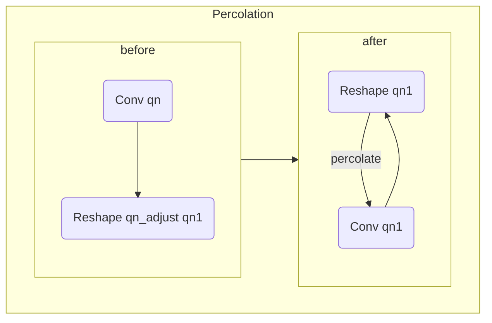
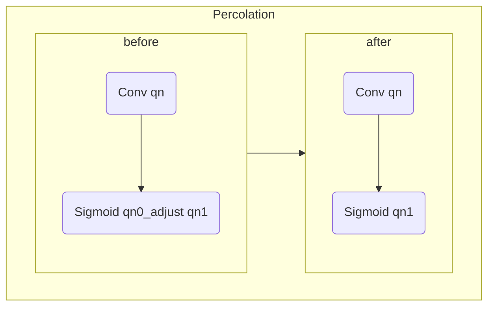
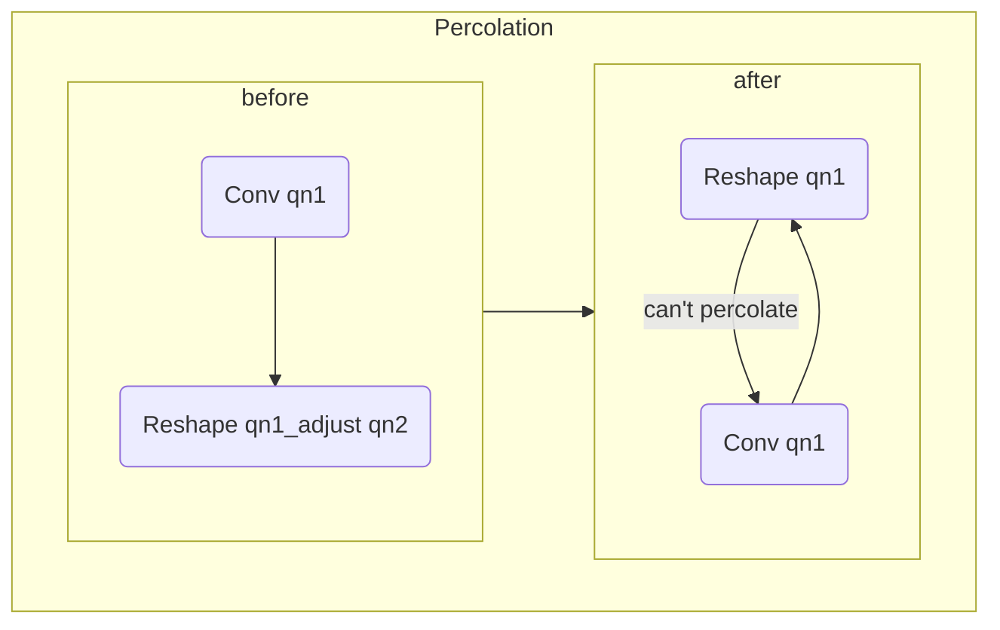

# Layer Name Mapping

## Case: N -> 1 
In case of pattenmatching a group of nodes to 1 ARA implemented OP, we replace the subgarph and maintain the last-layer name in the replaced node. 

```mermaid 
flowchart LR
  subgraph N->1 Mapping
    direction LR
    subgraph src
        f0(A) -->f1(B)
        f1 --> f2(C)
        
    end
    subgraph ara
        f5(A)
    end
  end
  src --> ara
```


## Case 1 -> N 

In case where a single op is mapped to multiple ARA ops, the last op preserves the layername. 

```mermaid 
flowchart LR
  subgraph N->1 Mapping
    direction LR
    subgraph src
        f0(A)      
    end
    subgraph ara
        f1(A_ara_1) --> f2(A_ara_2)
        f2 --> f3(A) 
    end
  end
  src --> ara
```

## Case M -> N
> Assumption: Only one output node only in src pattern
In case of pattern-matching multiple nodes to a pattern of nodes in dv, we will preserve the last layer name in the mapped graph. Other names are replaced with custom ara names. 


```mermaid
flowchart LR
  subgraph N->1 Mapping
    direction LR
    subgraph src
        f0(A) --> f8(B)
        f8 --> f10(C)   
        f8 --> f11(D)
        f11 --> f12(E)
        f10 --> f12   
    end
    subgraph ara
        f1(custom_ara) --> f2(custom_ara)
        f2 --> f3(E) 
    end
  end
  src --> ara
```

# Layerwise Qn.txt 

## Route 1 
* Exact layer name from `converted prototxt` 

## Qn assumption (algo)

Scenario:
1. If my current layer is PassThrough layer, check percolation is possible. If yes percolate it to the parent.


2. If my current layer is Not PassThrough layer, update the Qn.

Note: Start this Algo only if the Qn Adjustment is not present on before hand.

